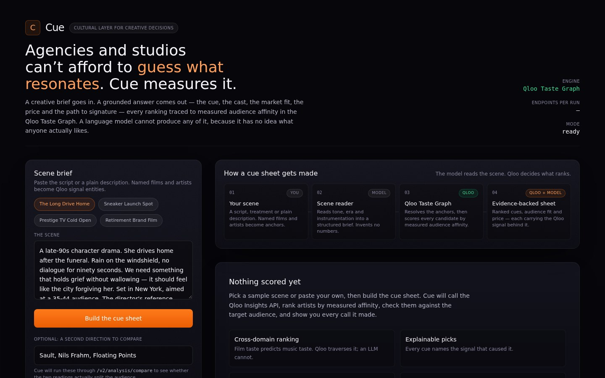
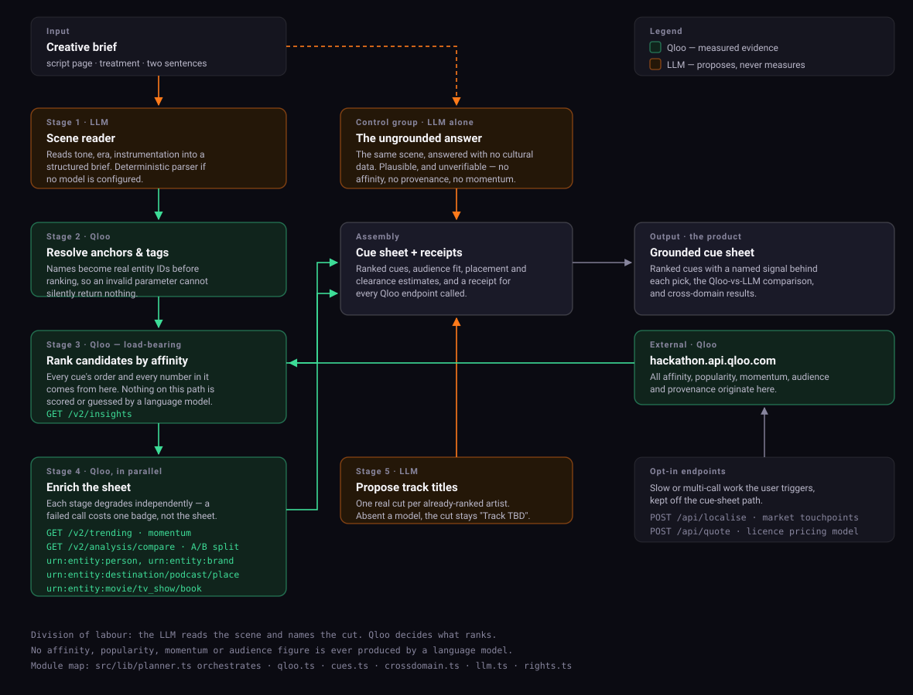
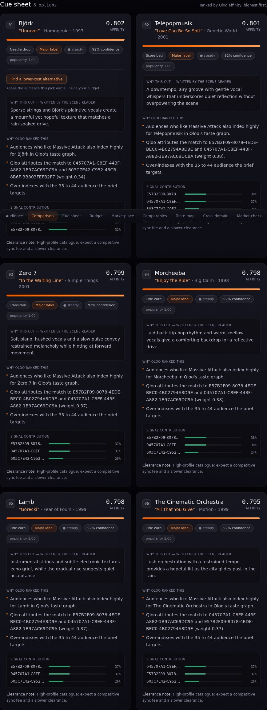
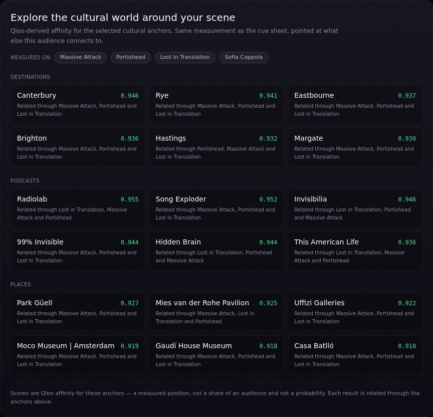
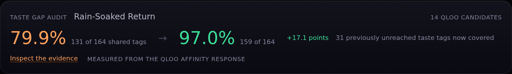
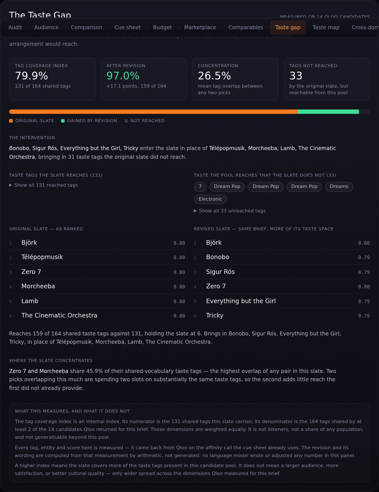
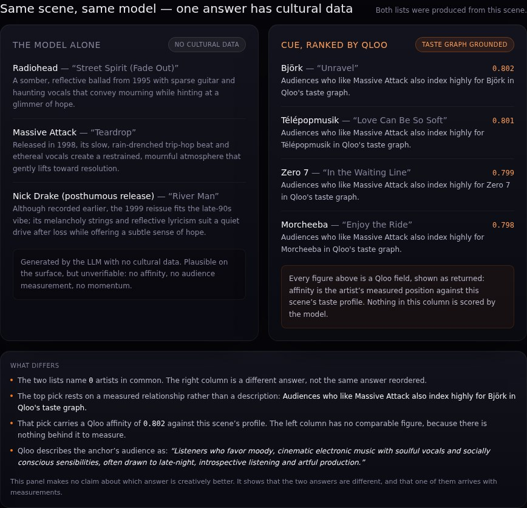
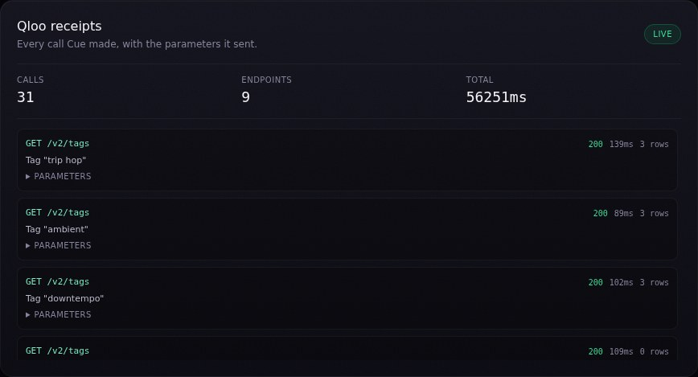
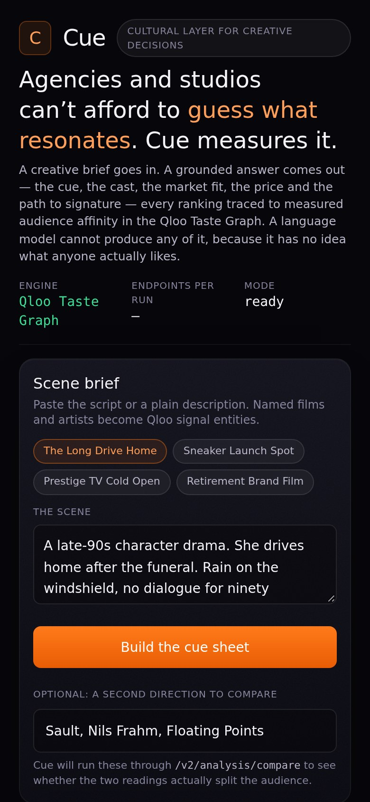

# Cue

[](https://github.com/itzebe/cue/actions/workflows/ci.yml)

**A creative brief goes in. A culturally grounded cue sheet comes out.**

> **[▶ Try Cue live](https://cue-nine-iota.vercel.app/)** — no signup, no key. Paste a scene or
> pick a sample, and the full pipeline runs against the real Qloo Taste Graph.

Cue is an agentic music supervisor for film, TV and advertising. You paste a scene — a script
page, a treatment, or two sentences — and Cue returns ranked music cues, where every ranking
traces back to **measured audience affinity** in the [Qloo Taste Graph](https://docs.qloo.com/)
rather than to what is merely famous.

Built for the [Qloo Agentic Hackathon](https://qloo.devpost.com/).

> **The problem in one line:** ask a language model to score a scene and it reaches for the most
> statistically common answer — *Hallelujah* for a funeral, *Smells Like Teen Spirit* for a 90s
> montage — because it knows which songs are famous and has no idea which songs fit *this*
> audience. Cue measures that instead of guessing it.



**[▶ Watch the product demo (2:35)](https://github.com/itzebe/cue/releases/tag/demo-video)** —
a single live run, recorded end to end against the real Qloo Taste Graph: brief in, cue sheet,
Cross-Domain Taste Map, comparison and the Qloo receipts behind each pick.

> The demo is hosted as a GitHub release asset, so the link **downloads** the MP4
> ([direct file](https://github.com/itzebe/cue/releases/download/demo-video/cue-demo.mp4),
> 24 MB) rather than streaming in the browser.

---

## For judges

Everything the submission needs, in one place:

| | |
|---|---|
| **Live demo** | [cue-nine-iota.vercel.app](https://cue-nine-iota.vercel.app/) — hosted on Vercel, no signup, no key |
| **Source** | [github.com/itzebe/cue](https://github.com/itzebe/cue) — public, MIT |
| **Run it locally** | `npm install && npm run dev` → [localhost:12000](http://localhost:12000). Works with no keys at all (see [Run it](#run-it)) |
| **Verify it** | `npm run verify` (167 checks) · `npm run reproduce` (rebuilds the Taste Gap figures offline) · `npm run reproduce:benchmark` (exhaustive null distribution) |
| **The Qloo difference** | [The Taste Gap](#the-taste-gap) — a measurement no LLM can produce, on a feature that would not exist without the taste graph |

**The sixty-second read.** A brief goes in; Qloo ranks artists by measured audience affinity and
Cue assembles a cue sheet where every number is traced to a Qloo call. The distinctive part is the
Taste Gap: eight individually defensible picks can still all serve one corner of the audience, so
Cue measures how much of the candidate pool's shared taste the slate actually reaches, and what a
different arrangement would reach instead. It is the first panel on the page once a sheet exists.
The numbers are reproducible from the committed Qloo responses with `npm run reproduce` — no key
and no network required.

**How Qloo is load-bearing.** Remove the Qloo API and there is no product: affinity ranking, the
taste tags the audit counts, momentum, audience fit, the cross-domain map and casting all originate
there. The LLM only reads the scene and names a track. A generic LLM asked the same brief returns a
plausible list; Cue returns one it can defend with a number. The README states exactly which
figures are measured and which are modelled — see [What is honest and what is not](#what-is-honest-and-what-is-not).

---

## The problem, and who has it

**The user:** a music supervisor, or a creative producer at an agency or studio, choosing music for
a scene under deadline.

Their job is to find a track that fits the scene *and* lands with the audience the scene is made
for — then to defend that choice to a director, a client, and a clearance team. Generic
recommendation tools cannot help with the part that matters: they rank by popularity and ratings,
which says nothing about whether a track fits a specific audience for a specific scene.

Language models do not close the gap. They produce confident, plausible, identical answers because
they hold no cultural data at all. A supervisor needs measured evidence, and needs to know which
part of the output is measured versus estimated.

## What Cue does

Paste a scene brief and Cue returns a full cue sheet:

- **Culturally grounded options.** Artists ranked by *measured* affinity with the scene's taste
  profile, not by what's popular.
- **A reason attached to every pick.** Each cue names the signal that caused it, using Qloo's
  explainability data. No black box.
- **Audience fit.** Demographic signals confirm the pick lands with the people the scene is for.
- **Momentum.** Qloo's own trend series, so a supervisor knows whether a cue reads current or
  nostalgic.
- **Placement and clearance notes.** Which cue is the needle drop, which is the score bed, and what
  each will cost to clear.
- **A creative A/B.** Two competing directions run through `/v2/analysis/compare` to see whether
  they split the audience or share it.
- **A clearance desk.** Select the cues you want and Cue prices the grant: fee band, rights holders,
  one-stop or two negotiations, the path to signature, and the day the campaign is gated.
- **A substitute when the answer is unaffordable.** The top pick costs more than the budget, or the
  label refuses. Cue inverts the budget into a popularity ceiling, searches the taste graph for
  artists the same audience already loves inside it, and reports each one's measured audience
  overlap with the original. This is the question a ranked list cannot answer, and the one
  supervisors actually get stuck on.
- **Cross-domain answers.** The same taste profile that ranks the music ranks people for casting and
  brands for partner fit, and returns the cultural touchpoints each market would reference.
- **Full receipts.** Every Qloo endpoint called, with parameters, status, latency and row count.

## How Cue works

Cue is a deterministic, multi-stage pipeline. The LLM and Qloo have strictly separated jobs, and
that separation is the whole design:

- **The LLM reads the scene** into a structured brief, and **names a specific track** for each
  artist Qloo has already ranked. It uses structured tool-call schemas (`emit_scene_brief`,
  `emit_tracks`) rather than free text.
- **Qloo decides what ranks.** Every affinity, popularity, momentum, audience-fit and provenance
  figure comes from the Qloo API. No language model produces or estimates any of those numbers.



The pipeline, in order: read the scene → resolve anchors and tags to Qloo entity IDs → rank
candidates by affinity → audit the selected slate against the whole candidate pool (the Taste Gap,
pure computation over the ranking response) → enrich in parallel (momentum, cross-domain people and
brands, comparables, cross-domain taste map) → assemble placement, clearance and receipts.

Each stage degrades independently: a failed trending call costs one cue its momentum badge, not the
whole sheet. Every failure is surfaced in the receipts panel rather than hidden.

**On "agentic".** Cue satisfies the hackathon's definition as an agentic tool: a multi-stage
workflow with LLM tool-calling and external retrieval. It does **not** run a multi-turn autonomous
loop, and it does not expose an MCP server — so this README does not claim either.

## The cue sheet



Each cue carries its own evidence: the affinity that ordered it, the popularity figure kept
deliberately separate, the signal entity that caused it, and a proposed cut. The cut title is the
only part a model proposes, and it is labelled as such.

## Cross-domain taste map

The same measured taste profile that ranks the music also answers the neighbouring questions.



- **What it returns:** recommendations across destinations, podcasts and places, from the same
  anchors that drove the cue sheet.
- **Where the numbers come from:** Qloo `/v2/insights`, requested per domain. Each row keeps its
  own provider-backed affinity where Qloo returned one.
- **Source attribution is preserved.** When Qloo's explainability data attributes a result to a
  specific anchor, Cue shows that. When no attribution block comes back, the row says the result
  relates through the anchors collectively rather than implying each anchor supports it.
- **Measured affinity is distinguished from a popularity-derived substitution.** Every entity
  carries an `affinitySource` field, and a row that fell back to popularity is never labelled
  "affinity".
- **Affinity is a decimal, not a percentage of shared audience.** Values like `0.9728` are Qloo's
  affinity for that entity against this taste profile. They are not a share of people, not a
  probability, and not a measure of audience overlap. Cue renders them as decimals and never
  multiplies them into a percentage.
- **Results are not presented as stronger than the provider response supports.** An empty domain
  and a failed domain are reported as two different things, so a Qloo fault never renders as "this
  audience likes nothing here".

**What it contributes to the central use case:** it is the difference between a music tool and a
cultural layer. A supervisor working a scene is often also answering "where would this campaign
shoot", "which podcast would carry it", and "who does this audience actually follow". The taste map
answers those from the same measurement instead of a second, ungrounded guess.

## The Taste Gap

A cue sheet can rank eight individually defensible picks and still circle one corner of the
audience. Every other panel here measures picks one at a time; none measures what the slate as a
whole covers. The Taste Gap asks that question and answers it with Qloo data.

It is the first thing the page shows once a sheet exists — the audit headline opens the results
column, and the full evidence panel sits below the cue sheet. The headline is the thirty-second
read: the brief, the baseline, the result, and the number of previously unreached taste tags the
revision now covers.



*One live run, so the figures are this pool's, not constants — the index is pool-relative by
construction. [The table below](#measured-on-live-qloo-and-reproducible-offline) is the reproducible
one: same code, a recorded pool, checked by `npm run reproduce`.*

### The measurement, exactly

The index is one division, with the numerator and denominator both displayed in the product so a
reader can check the arithmetic rather than trust the headline:

```
                     distinct shared taste tags the slate's entities carry
Tag Coverage Index = ──────────────────────────────────────────────────────── × 100
                     distinct shared taste tags across the whole candidate pool
```

- **A dimension is covered** when at least one selected entity carries it.
- **The vocabulary** is every tag carried by at least two *distinct* candidates in the pool. A
  tag on a single candidate is that entity's own metadata, not common cultural ground.
- **Dimensions are weighted equally.** There is no defensible reason to prefer one taste tag over
  another without evidence, so equal weighting is the default and the only setting the product
  uses. The engine accepts explicit weights and reports which were used, but Cue does not pass any.
- **Duplicates never inflate a count.** A repeated tag on one entity counts once, and the same
  entity returned twice in a pool counts as one piece of evidence — two copies are not two
  independent observations.
- **Both sides of the comparison use the same denominator.** The original slate and the revision
  are measured by the identical function against the identical pool union, which is what makes the
  delta meaningful rather than two different calculations sharing a name.

### What it is not

- **Not a share of listeners or of any population**, and not a probability. The denominator is the
  union of tags across the candidates Qloo returned *for this brief*, and it does not generalise
  beyond that pool. The panel states this in as many words, because a coverage number is easy to
  overstate.
- **Not a count of taste clusters.** Grouping entities into clusters would need a documented
  clustering method and a defensible *k*; tag overlap supplies neither. Cue reports overlap.
- **Not proof of audience reach, satisfaction, purchase intent or commercial success.** A higher
  index means the slate covers more of the taste tags present in this candidate pool — wider spread
  across what Qloo measured, nothing more.

### Why the vocabulary is restricted to tags shared by 2+ candidates

Raw tag counts track how richly Qloo has catalogued an artist, not how broad their cultural reach
is — the measured range was 44 to 100 tags *within a single pool*. Ranking on the raw universe made
the optimiser simply pick the most-documented entities (Bonobo 100, GusGus 95, Yppah 86) and call it
coverage. The threshold removes that bias, and the tests assert it directly.

### The revision

It seeds the brief's top-ranked pick and never discards it — the affinity ranking is the brief's
strongest answer, and a "revision" that dropped it would be answering a different brief. Remaining
slots take whichever candidate adds the most uncovered tags, holding slate size fixed. Ties break on
pool order, so the result is deterministic for identical input; affinity is deliberately not a
tiebreaker, because a cross-domain discovery pick's affinity comes from a different Qloo call and is
not on the same scale.

Improvement is only ever reported when the index actually rose. When no reordering helps, the panel
says the original slate stands rather than manufacturing a gain.



### Scored by the metric it optimises

The revision is chosen by the index and then reported by it, which is a circularity worth naming
rather than hiding. The "after revision" figure is therefore the best value this measure reaches in
this pool — a ceiling, not independent confirmation that the revised slate is better. What the
comparison does establish is the size of the gap between the affinity order and what the pool
allows, which is the decision a supervisor actually faces. The panel prints this caveat alongside
the numbers, and `npm run reproduce` lets a reader change the selection rule and watch the figures
move.

### No extra API calls

The metric is computed from the `tags[]` Qloo already returns on the affinity call
(`feature.explainability=true`). Live probing confirmed those tags are a superset of what
`/v2/analysis/compare` reports for the same entity, so no second request is needed. The feature adds
no latency and no cost.

### Unmeasurable is reported as unmeasurable

A pool too small or too sparse to measure shows the limitation, never a zero. A zero would read as
"this slate reaches nothing", which is a different and false claim. The result also carries
evidence warnings — a selection index outside the pool, for instance — and the panel renders them
rather than presenting a flagged measurement as clean.

### Measured on live Qloo, and reproducible offline

The index is pool-dependent by construction — the denominator is the tag union of the candidates
*that brief* returned — so a figure only means something alongside the pool it was measured on.
Rather than quote numbers a reader has to take on trust, the raw Qloo responses behind them are
committed: `docs/reference-pool.json` holds the entities Qloo returned for each brief below,
recorded from the hackathon API, and `npm run reproduce` rebuilds each pool from that file and
recomputes the index **through the production coverage module** with no network access:

```bash
npm run reproduce   # 3 checks, no API key, no network
```

| Brief | Index | After revision | Gain | Tags not reached |
|---|---|---|---|---|
| Massive Attack + Portishead | 90.6% (135/149) | 98.7% (147/149) | +8.1 | 14 |
| Sault | 78.4% (109/139) | 100.0% (139/139) | +21.6 | 30 |
| Nils Frahm | 96.8% (120/124) | 100.0% (124/124) | +3.2 | 4 |

Those rows are printed by `npm run reproduce`, which also asserts them, so they cannot drift away
from the code without the check failing. Every number is a count of tags against a pool, and every
input is in the repository — a judge can change the selection rule or the support threshold and
watch the figures move.

Two things the table does not say, and should not be read into it:

- **The numerator changes between runs of the same brief; the denominator held steady.** These three
  briefs returned 149, 139 and 124 shared tags on every recording — but the *picks* differ, because
  the app's tag set comes from its own reading of the brief text and Qloo's candidate ordering
  varies. An earlier recording of the same three briefs measured 84.6%, 69.1% and 89.5%, which is
  the same code on a different pool. The gain is a property of a pool, not a constant of the brief.
- **The revision is scored by the metric it optimises.** `reviseSelection` searches for the slate
  with the highest index and the panel then reports that same index. So the "after revision" column
  is the best value this metric reaches in this pool — it is a ceiling under this measurement, not
  evidence that the revised slate is better in any independent sense. What it does establish is the
  size of the gap: if eight picks can reach 98.7% of a pool's shared tags and the affinity ranking
  reaches 90.6%, the ranking is leaving reach on the table. What it cannot establish is that
  coverage of these tags is the same thing as serving the audience. The panel says so in its own
  words under "What this measures, and what it does not".

**What it contributes to the central use case:** it is the difference between a ranking and a
judgement. A supervisor is not only asking "what is the best track"; they are asking whether the
eight tracks they have chosen reach the audience they promised the client. This is the only panel
that answers that, and an LLM cannot: it knows two artists sound alike, not which taste tags each
one carries or how many of them the other picks already cover.

### Where the index sits in its own distribution

A raw index is not interpretable on its own. 90.6% sounds strong until you learn that a random
eight-entity draw from the same pool averages 92.7%. A pool of 14 candidates admits exactly
`C(14, 8) = 3003` distinct eight-entity slates, which is small enough to enumerate **completely**
rather than sample, so the null distribution below is exact and has no random seed:

```bash
npm run reproduce:benchmark   # 20 checks, no API key, no network
```

| Brief | Index | Slates | Null mean | Null p05–p95 | Coverage pct | Volume pct |
|---|---|---|---|---|---|---|
| Massive Attack + Portishead | 90.6% (135/149) | 3003 | 92.7% | 85.9–97.3 | 24.5 | 44.0 |
| Sault | 78.4% (109/139) | 3003 | 90.5% | 82.0–97.1 | 1.2 | 59.3 |
| Nils Frahm | 96.8% (120/124) | 3003 | 92.9% | 83.9–98.4 | 85.7 | 84.6 |

**The definition.** The index is `|covered(slate)| / |vocabulary| × 100`, where the vocabulary is
the set of tags carried by at least `MIN_TAG_SUPPORT` (2) distinct entities in that pool, and
`covered` is the union of the slate's eligible tags. It is computed from the `tags[]` Qloo already
returns on the affinity call, so it adds no request. It is **pool-relative**: the denominator is the
tag union of the candidates *that brief* returned, not a share of listeners, of the market, or of
any population.

**The null.** Every eligible slate is enumerated with the production `measureSlate`, and the 3003
count is derived from the pool and slate sizes by a binomial coefficient, not hardcoded — it is a
consequence of this pool, not a constant. The gate recomputes the whole distribution on every run
and asserts the recorded summary against it, so the recorded null cannot drift from the code.

**The percentile.** The share of enumerated slates the arm's score beats, computed here as a
midrank: ties count as half. The null is a discrete score with heavy ties, so the convention is
stated in the artifact rather than assumed — "fraction strictly below" would push a slate sitting
on a plateau to the bottom of that plateau, and the choice moves a percentile by a few points at
most. Percentiles are **recomputed during replay from the reproduced score and the recomputed null**;
they are never read from the artifact, so a stale rank cannot survive a rerun.

**Why a high index does not establish ranking quality.** The index measures how many distinct tags a
slate reaches, not whether the picks are good ones. It is monotone in tag count, so a slate can
raise it by including richly catalogued entities. The `Volume pct` column exists to show that
directly: the affinity slate sits at the 44th percentile by tag count alone but the 24.5th by
coverage, and on the Sault brief 59.3rd by volume against 1.2nd by coverage. The two columns differ
by 20–58 points, which is the evidence that the index is not merely a proxy for catalogue
completeness — but the residual correlation is real and is why the raw figure should never be quoted
without its percentile.

**Why coverage and affinity are different objectives.** They are close to statistically independent
across these slates (correlation of affinity-sum against coverage: 0.005, −0.19, 0.36). A slate
chosen to maximise affinity is therefore **not expected** to top a coverage distribution. The
affinity slate ranking at the 1st–24th coverage percentile is the expected outcome of a different
objective, not evidence that the ranking is wrong. The same gate shows the metric is not degenerate:
the greedy revision sits at the 99.5th, 99.9th and 99.9th percentile.

**What these measurements cannot support.** Three briefs from one recorded API snapshot cannot
generalise beyond those briefs. No human-preference evaluation has been performed — nothing here
measures whether anyone likes the result, and the index must not be described as quality,
satisfaction, or audience approval. **No LLM-only baseline was evaluated**, so no claim is made that
Cue beats one. The gate also prints a `Volume pct` for the affinity ranking, which is a tag-count
statistic, not an LLM evaluation and not a substitute for one.

The same four honesty rules the rest of the panel follows apply here: the null is enumerated rather
than sampled, the percentile is derived rather than stored, the volume comparison is reported
alongside the coverage figure rather than instead of it, and every figure is a count of tags against
a committed pool.

## What Qloo contributes

The hackathon's test is whether a project would work the same without Qloo. Here it plainly would
not.

| Question the cue sheet answers | Qloo endpoint | Could an LLM answer it? |
|---|---|---|
| Who are the entities in this brief? | `GET /v2/search` | No — needs resolved entity IDs |
| Which artists share this scene's taste profile? | `GET /v2/insights` | No — requires measured affinity |
| Why was this artist chosen? | `feature.explainability=true` | No — requires the signal graph |
| Does it land with this audience? | `signal.demographics.*` | No — requires demographic data |
| Does the slate as a whole reach this brief's taste space? | `feature.explainability=true` tags, already returned | No — an LLM knows two artists sound alike, not which tags each carries or what the others already cover |
| Is this artist rising or cooling? | `GET /v2/trending` | No — requires a time series |
| Do these two directions share an audience? | `GET /v2/analysis/compare` | No — requires cross-group analysis |
| Which people and brands fit this audience? | `urn:entity:person`, `urn:entity:brand` insights | No — requires cross-domain affinity |
| What cultural touchpoints define this market? | `urn:entity:place` + `filter.location.query` | No — requires regional signals |
| What will this cost to clear? | Qloo popularity + momentum, then Cue's model | No — needs measured leverage |

Cue shows this in the product rather than asserting it. See the comparison below.

## Evidence, provenance and the comparison

The strongest single piece of evidence in Cue is that it runs its own control group. On the same
scene, Cue produces **two** answers: one from the model alone with no cultural data, and one ranked
by Qloo. The difference is shown side by side rather than claimed.



The baseline column is produced by a real model call on the same brief (`baseline.source` is `llm`
when the model answered, and `sample` when a labelled fixed example is used instead — the panel
says which). The Qloo column carries affinity, provenance and receipts the baseline cannot have.

This is a side-by-side demonstration, not a measured evaluation: it shows what each answer contains
on one brief. It does not establish that Cue outperforms an LLM.

Every claim in the sheet is traceable:



## The benchmark: Qloo against an LLM-only baseline

To find out whether the grounding actually changes the answer, there is a preregistered benchmark in
[`benchmark/`](benchmark/). It compares two arms on six identical briefs:

- **Arm A — LLM-only.** The model answers from parametric knowledge alone, with no Qloo data.
- **Arm B — Cue.** The production pipeline, ranked by Qloo.

Both arms come from **one response** of the deployed app. Cue already builds its own ungrounded
control group (`CueSheet.baseline`), so Arm A is the shipped code path rather than a
reimplementation, and its own `source` field says whether the model ran or a labelled sample was
substituted.

**The protocol was committed before the metrics were computed** ([`benchmark/protocol.json`](benchmark/protocol.json),
committed at `6d38c7d`). It freezes the arms, the briefs, the metric formulas, the tie handling, the
meaningful thresholds, and the criteria for support, contradiction and inconclusive — plus the
sha256 of the file, which is recorded in the results so the metric definitions cannot be quietly
changed after seeing the numbers.

### What the benchmark found

It did not find that Cue wins. All four preregistered hypotheses were inconclusive or contradicted,
and [`benchmark/results.json`](benchmark/results.json) reports exactly that:

| Metric | Result | Outcome |
|---|---|---|
| Brief relevance | Arm A matched brief vocabulary better, 6/6, median −0.50 | Contradicted — but see the sensitivity check |
| Anchor recycling | Neither arm recycled the named anchor | Inconclusive (no discrimination) |
| Recommendation diversity | Identical, both 1.0 distinct-artist ratio | Inconclusive (no discrimination) |
| Tag Coverage Index | Arm B +25 points on the one brief where Arm A was measurable at all | Inconclusive by construction |
| Human preference | Not performed | Not available — and no automated score is substituted for it |

Two of those results are worth more than the headline.

**The relevance result is a measurement artifact, and the benchmark says so.** Arm A's rationale is
written prose that tends to contain mood words; Arm B's is Qloo provenance boilerplate that cannot.
A lexical proxy therefore rewards Arm A for something other than relevance. A sensitivity block
recomputes the metric over artist and track only — dropping the rationale entirely — and there the
difference **disappears completely** (median diff 0.0000). Both bounds are published. A benchmark
that reported only the first number would be reporting the metric's bias as a finding.

**The coverage result is inconclusive because the measurement barely applies.** Coverage is
pool-relative, and Arm A answers open-book, so most of its picks do not exist in Arm B's pool at all.
Only one brief had any measurable Arm A pick. The protocol preregistered this as expected to be
inconclusive *before* the data existed, precisely so that a low Arm A figure could not later be
presented as a Cue win. An unmeasurable pick is recorded as unmeasurable, never scored as zero.

### A post-hoc finding the automated metrics missed

Building the blinded review worksheet exposed something the preregistered metrics do not measure.
Two briefs with **disjoint requested genres** — afrobeats/hip hop, and electronic/ambient/noir —
received a **byte-identical Arm B slate**: `Cachao`, `Peter Phillips: The Tallis Scholars`,
`God of Shamisen`, and four more, in the same order. Arm A's slates for those two briefs share
nothing. Across all 15 brief pairs, Arm B's mean slate overlap is 0.067 against Arm A's 0.013, and
the one pair with total overlap is that disjoint-genre pair.

This is reported as `exploratoryFindings` in the results, labelled `post-hoc` with its caveat,
because **it was not in the frozen protocol**. It is a lead, not a settled result: n = 6, and one
identical pair could be a coincidence of the tag-only path. It is consistent with the limitation
already documented below — when a brief names no artist or film, `/v2/insights` matches on tags
alone and returns a low-spread affinity, so Qloo has little signal to separate the briefs with. The
finding is that the comparison makes it visible; the fix belongs in the pipeline, not the benchmark.

### What this does and does not establish

It establishes that the comparison is reproducible and that its own weaknesses are reported. It does
**not** establish that Cue recommends better music than an LLM: that requires human listeners, and
the metric for it is present but empty rather than filled with a proxy.

The limits are stated in the artifact rather than left to be discovered:

- **Pool parity is not achievable.** Arm A is never given a candidate pool, so pool-relative metrics
  cannot be compared like-for-like. The smallest safe fix — a closed-book variant that hands both
  arms the same list — would change what Arm A means, so it is named in the protocol and
  deliberately not implemented.
- **Relevance is a lexical proxy**, not a judgement, and applies no stemming.
- **n = 6.** A one-sided sign test gives p = 0.0156 at 6/6 and p = 0.109 at 5/6, so a 5/6 result
  cannot be called significant at α = 0.05. This is stated up front so a weak result cannot later be
  presented as strong.
- **No composite score.** The metrics are not combined into one number, because no defensible
  weighting exists without human preference data.

### Reproduce it

```bash
npm run benchmark          # recompute every metric and assert it matches the committed artifact
npm run benchmark:verify   # the benchmark's own test suite (57 checks)
npm run benchmark:report   # the tables above
```

Replay needs **no network and no credentials** — it reads the committed raw responses and
recomputes. Recording new evidence is the only step that touches the network:

```bash
npm run benchmark:record     # call the deployed app once per brief, write raw evidence
npm run benchmark:pool       # rebuild each candidate pool and verify it against the recorded fingerprint
npm run benchmark:worksheet  # emit the blinded review worksheet and the X/Y mapping
```

The candidate pool is not in the app's response and coverage is pool-relative, so the pool has to be
rebuilt before the metric can be recomputed offline. `benchmark:pool` calls the same production
functions the planner calls, then checks the result against a fingerprint the deployment itself
recorded — pool size, vocabulary size, covered tags and redundancy. All six match exactly, including
the index to full precision, so the frozen pools are the pools that produced the published figures.
A mismatch writes nothing, and coverage becomes unavailable rather than being measured on the wrong
pool.

The human-preference metric is left **empty rather than filled with a proxy**. To run it, generate
the worksheet, have reviewers rate the two answers per brief without knowing which arm each is, then
copy `benchmark/reviews/TEMPLATE.json` and record their scores. The evaluator ignores the template
and any file with no numeric ratings, so an unfilled review cannot masquerade as a result.


## Mobile

The primary action is reachable without scrolling on common phone viewports.



## What is honest and what is not

Cue is built against a live API for a hackathon, so the boundary between measured and modelled is
stated in the product rather than blurred.

| Output | Source | Status |
|---|---|---|
| Affinity, popularity, momentum, audience fit | Qloo | Measured |
| Cross-domain recommendations and their affinity | Qloo (`/v2/insights` per domain) | Measured |
| Market touchpoints | Qloo (`urn:entity:place` + location) | Measured |
| Casting and brand candidates | Qloo (`urn:entity:person`, `urn:entity:brand`) | Measured |
| Audience overlap between two artists | Qloo (`/v2/analysis/compare`) | Measured |
| Tag Coverage Index and the revised slate | Qloo (`feature.explainability=true` tags) | Measured, over the returned pool only |
| Track titles | Optional LLM, else left for the supervisor | Never invented |
| Fees, splits, clearance timelines | Cue's own model | Estimated, labelled as such |

Two findings shaped the design and are worth stating plainly:

1. **Qloo's location filter does not move artist affinity.** Measured against the hackathon API,
   `filter.type=urn:entity:artist` returns byte-identical entities *and* affinity scores for Los
   Angeles, Sao Paulo, Seoul, Lagos and London. A feature claiming to "localise the soundtrack"
   would be fabricating its result, so Cue localises what the data actually supports —
   `urn:entity:place`, where markets diverge completely (Big Ben for London, the Ghibli Museum for
   Tokyo, zero overlap between markets). The music stays global because the data says it is global.
   Each market's places are then measured with the *same* Taste Gap the cue sheet uses, over their
   cultural dimensions only — which is the concrete proof that the metric is not music-specific.
2. **Clearance data is not available through Qloo.** Fees and splits are therefore produced by a
   transparent model with every input and multiplier shown in the UI, not presented as quotes.
   Inventing a real number would be the same failure as inventing a track title.

Cue does not clear music, does not replace a music supervisor, and does not assert that any
recommendation is licensable at a given price. Clearance figures are modelled estimates, labelled
as estimates in the UI.

## Technical implementation

Next.js 14 (App Router) + TypeScript + Tailwind. No agent framework and no runtime dependency beyond
React and Next — the pipeline is plain TypeScript in `src/lib/`.

| Module | Role |
|---|---|
| `src/lib/planner.ts` | Orchestrates the pipeline and assembles the cue sheet |
| `src/lib/qloo.ts` | Qloo client: search, insights, tags, trending, compare |
| `src/lib/cues.ts` | Anchor/tag resolution, affinity ranking, momentum |
| `src/lib/crossdomain.ts` | Cross-domain taste map across destinations, podcasts, places |
| `src/lib/casting.ts`, `comparables.ts` | People/brands and "what is this like" |
| `src/lib/localise.ts` | Market touchpoints and per-market cultural coverage (opt-in endpoint) |
| `src/lib/cultural.ts` | The cultural vocabulary for venue localisation (fail-closed allowlist) |
| `src/lib/rights.ts` | Transparent fee and clearance model |
| `src/lib/substitute.ts` | Budget-aware substitution via audience overlap |
| `src/lib/audit.ts` | The domain-agnostic coverage engine: measurable dimensions, selection scoring, greedy revision. Equal weighting by default, explicit weights supported |
| `src/lib/coverage.ts` | The music adapter over the engine: Qloo tags to dimensions, and the music-facing result the panel renders. Pure computation, no API calls |
| `src/lib/llm.ts` | Provider resolution, fallback chain, tool-calling |

### Endpoints

| Route | Purpose |
|---|---|
| `POST /api/cue` | Scene brief in, grounded cue sheet out. The core call. |
| `POST /api/localise` | Compare the brief's cultural touchpoints across markets. Slow by nature, so it is opt-in. |
| `POST /api/quote` | Price a selected basket: fee bands, rights holders, clearance path, gating day. |
| `POST /api/substitute` | Find what else serves the scene inside a budget. Opt-in, because it costs several calls. |
| `GET /api/cue` | Health check: whether Qloo and an LLM are configured, and against which base URL. |

## Verification

```bash
npm run verify               # 167 checks
npm run reproduce            # 3 checks: rebuilds the README's Taste Gap table offline
npm run reproduce:benchmark  # 20 checks: exhaustive null distribution for the same briefs
npm run benchmark            # replay the Qloo-vs-LLM-only metrics and assert they match the artifact
npm run benchmark:verify     # 57 checks: the benchmark's own verification suite
npm run typecheck            # tsc --noEmit
npm run build                # production build
```

`npm run verify` prints a `passed`/`failed` line and exits non-zero on any failure. It currently
reports **167 passed, 0 failed**. The only thing stubbed is `fetch` — the real HTTP boundary. Every
layer under test is the production code path, exercised with response bodies shaped like real Qloo
payloads. Coverage includes normalisation, affinity extraction, explainability parsing, momentum
derivation, failure degradation, cue assembly, concurrency limits, request-budget accounting,
place-based localisation, casting, cross-domain comparables, the cross-domain taste map, the
audience brief, licence pricing, and the coverage audit (vocabulary thresholding, duplicate
handling, malformed evidence, determinism, the revision's seed invariant, the unmeasurable-pool
state, equal versus explicit weighting, and the separation of a failed measurement from a
legitimate empty one). The cultural vocabulary and the venue Taste Gap are covered too: the
allowlist's inclusions and exclusions, fail-closed behaviour for unknown namespaces, malformed tag
handling, the per-market measurement, and that a revision which cannot improve is never reported as
one.

## Known limitations

- **Momentum reads "steady" on live data.** The trend series exposed by the hackathon sandbox is a
  frozen snapshot: `population_rank_velocity`, `population_percent_delta` and
  `population_percentile` are constant across every artist tested. The field is parsed, ranked and
  rendered; it simply reports "steady" rather than fabricating a trend. The unit tests cover the
  rising and cooling branches with a varying series.
- **Tag-only briefs are scoped by tags, then ordered by popularity.** When a brief names no film,
  director or artist, `/v2/insights` does not restrict its candidates on tag *signals* — the
  hackathon key returns the same entities for death metal as for polka. Cue therefore applies the
  brief's resolved genre and mood tags as a `filter.tags` candidate filter, which is what makes the
  pool brief-specific. Within that pool the affinity is still uniform, so Cue detects the zero
  spread and orders by popularity as a deterministic tiebreak, saying so in the warnings rather than
  presenting an arbitrary order as a ranking. Naming an anchor restores true affinity ranking.
  `filter.tags` is a union, so a brief whose tags match nothing falls back to the unscoped ranking
  with a warning that says the slate is not filtered to the brief.
- **No "song" entity type exists in Qloo.** Cue grounds the *artist* and *vibe* with Qloo, then
  proposes specific tracks from those artists. This is stated openly rather than papered over.
- **Clearance is a model, not a quote.** Fee bands, splits and timelines are Cue's own transparent
  estimate, with every input shown. They are not real quotes and not legal clearance.
- **A cue sheet takes roughly 20 seconds.** It issues 20+ Qloo calls; the hackathon key rate-limits
  in bursts, so the client caps concurrency at four in flight and retries with backoff.
- **The comparison baseline can fall back to a fixed sample.** When the model does not return a
  baseline, the panel labels the left column as a fixed sample rather than dressing it up as a live
  comparison.

### Notes for reviewers

- **Hackathon base URL.** Hackathon keys only work against `https://hackathon.api.qloo.com`. Using
  staging or production returns 401. This is the default here.
- **Authentication.** Qloo expects the key in the `X-Api-Key` header, not as a bearer token.
- **`/v2/insights` is a GET.** Parameters go in the query string; a POST body will fail.
- **Invalid parameters fail silently.** Qloo ignores unsupported parameters and returns `200` with
  an empty entity list rather than an error. Cue resolves entities and tags *before* ranking, which
  is why the call chain has more steps than a naive integration — and why it does not quietly
  return nothing.
- **Legacy `/recs` and `/recommendations` are unsupported** for the hackathon and are not used
  anywhere in this codebase.
- **Anchor extraction is load-bearing, so it is tested.** Whether a brief gets true affinity ranking
  or the flat tag-only fallback is decided entirely by whether Cue can find a named reference in the
  text. The reader handles the shapes supervisors actually write — single-word titles (`Drive`,
  `Sicario`), titles with lowercase connectors (`Under the Skin`), quoted phrases, and
  `and`-separated lists, which split into separate entities rather than merging. It excludes
  sentence-initial words capitalised by grammar, regions and US states (those are routed to
  `region`, since a place is not a taste entity), and phrases that begin with a stopword (`Set in
  New York`, `US and UK`). The four bundled sample scenes are part of the test suite for this
  reason: a sample that silently degrades to a flat ranking is a bad first impression.
- **Location does not move artist affinity.** See "What is honest and what is not" above. This was
  measured, not assumed, and it is the reason localisation targets places.
- **Market calls are slow and are budgeted for.** A location-filtered `urn:entity:place` query ran
  between 3.6s and 19.2s against the sandbox, well past the 12s default, so `/api/localise` runs its
  markets in parallel with a 25s per-call budget rather than serialising them inside the cue sheet.
- **A retained-affinity ratio is not a quantity, so Cue does not show one.** The obvious way to
  describe a cheaper substitute is "keeps 90% of the original's audience fit". That number is
  meaningless here. The original's affinity comes from an uncapped `/v2/insights` call and a
  substitute's comes from a `filter.popularity.max`-capped one, so each is a rank within a
  *different* candidate set. Measured live, capped-pool affinities ran *above* the uncapped
  target's, which is how a first draft reported "keeps 115%" and recommended an artist sharing 13%
  of the audience. Cue removed the ratio entirely and leads with audience overlap from
  `/v2/analysis/compare`, which is measured against the target directly and is therefore comparable.
  Affinity still orders the candidates *within* one pool, where the candidate set is shared.
- **The audience-overlap floor is calibrated, not guessed.** Overlap separates real substitutes from
  lookalikes far more sharply than shared genre tags do. Measured against the hackathon API:
  Portishead and Lamb `0.563`, Portishead and Hooverphonic `0.545`, Massive Attack and Tricky
  `0.531` — all genuine same-audience pairs — while Portishead and Kendrick Lamar `0.185` and
  Portishead and Gogo `0.125`, which share a genre tag but not an audience. Cue treats `0.30` as the
  floor for calling something a substitute, and says so in the warnings when nothing clears it
  rather than letting the closest option read as a swap.
- **`signal.demographics.age` rejects anything but its own bucket names.** A raw brief value like
  `25-34` returns `400`, which fails the *entire* request rather than narrowing it — so an
  unnormalised age silently empties every response that carries one. This was found by probing the
  API directly, not from the docs. Cue normalises at the single `insights()` choke point, so no
  caller can bypass it, and drops an unrecognised value rather than forwarding it: losing a
  demographic narrows a query, whereas passing one through destroys it.
- **Demographics *replace* the audience on `urn:entity:person`, so Cue does not send them there.** A
  demographic is supposed to narrow a query. On person entities it does something else. Anchored on
  *Drive* (2011), the undemographic call returns action leads — Stallone, Statham, Bruce Lee — and
  the same call with `age=25_to_29` returns an unrelated cluster (Shruti Haasan, MS Dhoni); only 2
  of 15 entities appear in both. It repeats across anchors and every age bucket, and `gender` alone
  has the same effect. The failure is dangerous precisely because the output still looks like a
  plausible list of names, so nothing downstream can detect it — Cue would have shown one audience's
  people as another's. Brands behave the opposite way: the same comparison keeps 4–8 of 10 entities
  and stays on-theme (*Drive* yields Aston Martin, Audi and Lamborghini either way), so demographics
  are kept there. The asymmetry is not documented by Qloo; it was measured, and the unit test
  asserts the person query carries no demographic parameters at all.
- **Typo tolerance is off on purpose.** With `feature.typo_tolerance=true`, Qloo fuzzy-matches
  unrelated tags — `tension` → *Venison*, `dark` → *Park*, `open` → *Oven* — which silently corrupts
  the grounding. Tag resolution pins `feature.typo_tolerance=false` so a tag means what it says.

## Run it

```bash
npm install
cp .env.example .env.local   # add your QLOO_API_KEY
npm run dev                  # http://localhost:12000
```

**It runs without any keys.** With no `QLOO_API_KEY`, Cue serves a pre-computed fixture cue sheet
through the exact same rendering path, so you can explore the full product before a hackathon key
arrives. The mode badge tells you which path you are on (`live` vs `fixture`).

One thing the keyless path does not show: **the Taste Gap**. That measurement needs the candidate
pool Qloo returns for the brief, and a fixture has no pool behind it — the panel is derived, not
hard-coded, so it has nothing to compute from. It stays hidden rather than showing invented
numbers, which is the same rule the rest of the product follows. The live demo runs with a key, so
the audit is there. To see it locally, set `QLOO_API_KEY`; to check the arithmetic without a key at
all, run `npm run reproduce`, which recomputes the README's figures from committed Qloo responses.

To see the full experience including the live comparison baseline, set an LLM key as well — see the
environment table below. Without one, Cue uses its deterministic scene reader and the sheet labels
it as such.

### Environment

| Variable | Required | Purpose |
|---|---|---|
| `QLOO_API_KEY` | for live mode | Your Qloo hackathon key |
| `QLOO_API_BASE_URL` | no | Defaults to `https://hackathon.api.qloo.com` |
| `LLM_API_KEY` / `LLM_BASE_URL` / `LLM_MODEL` | no | Any OpenAI-compatible endpoint (all three, to override everything else) |
| `OPENROUTER_API_KEY` / `GEMINI_API_KEY` / `GROQ_API_KEY` | no | Set one and Cue infers the base URL and model |

Resolution order, highest first: the `LLM_*` triple, then `OPENROUTER_API_KEY`, `GEMINI_API_KEY`
(or `GOOGLE_API_KEY`), then `GROQ_API_KEY`.

There is no implicit OpenAI endpoint, and that is a deliberate choice. A paid key with no balance is
worse than no key at all: every cue sheet becomes a paid call that fails, and the app silently drops
to the deterministic reader while reporting a configured model — which is exactly what happened in
production before this was changed. A bare `OPENAI_API_KEY` therefore resolves to nothing. To use
OpenAI, name it with the `LLM_*` triple. `OPENAI_API_KEY` is still read as the credential for the
Agent Canvas managed proxy, which is identified by its own refresh URL rather than by the variable
name.

**Every configured provider is a fallback for the one above it.** Cue builds the ordered chain above
and tries each provider once, in order, until one answers. A rate-limited or unfunded primary hands
the same request to the next provider instead of giving up while a working key sits unused.
Providers are never retried within one request: a rejected key or an exhausted balance is permanent
for that provider, so repeating it only adds latency. The chain shares a single time budget rather
than one per provider, so a fallback cannot silently double the wall-clock cost of a cue sheet. When
a later provider answers after an earlier one failed, the sheet says so and names the provider that
succeeded.

The `LLM_*` triple is terminal: setting all three names an endpoint deliberately, so no fallback is
attempted.

Qloo is the required half; the LLM is optional and only names the specific track. Without it, Cue
still ranks artists from the taste graph and leaves the cut as "Track TBD" rather than inventing a
title. With it, each ranked artist gets a real track, album and year plus a rationale for the
placement.

Set `LLM_MODEL` explicitly when your endpoint does not serve the preset default (each provider's own
default is listed in the table below; the Agent Canvas proxy defaults to
`claude-sonnet-4-5-20250929`). A model your key cannot access returns `403`, and Cue degrades to
"Track TBD" cues; the server log names the rejected model so the cause is visible instead of silent.

**A configured key is not assumed to work.** Cue spends one call and, if the provider refuses it,
classifies the refusal — exhausted balance, rejected key, unavailable model, rate limit, timeout —
and says which one in the cue sheet, in the cue cards, and in `GET /api/cue?probe=1`. Rankings,
market fit and pricing are unaffected, because those come from Qloo and not the model. The
deterministic parser runs instead of the LLM, and the sheet labels it as such. `GET /api/cue` reports
the resolved provider, base URL and model without spending a call.

#### Free OpenAI-compatible providers

Track naming is optional, and a paid OpenAI key is not required to turn it on. Set the provider's own
key and Cue infers the rest:

| Provider | Key variable | Default model | Where to get a key |
|---|---|---|---|
| Groq | `GROQ_API_KEY` | `openai/gpt-oss-120b` | [console.groq.com](https://console.groq.com/keys) |
| Google Gemini | `GEMINI_API_KEY` | `gemini-2.5-flash` | [aistudio.google.com/apikey](https://aistudio.google.com/apikey) |
| OpenRouter | `OPENROUTER_API_KEY` | `openai/gpt-oss-120b` | [openrouter.ai/keys](https://openrouter.ai/keys) |

Any other OpenAI-compatible endpoint also works with no code change: set all three of `LLM_API_KEY`,
`LLM_BASE_URL` and `LLM_MODEL` to override every preset.

The defaults are chosen to be IDs the provider actually serves today, because a preset pointing at a
retired ID fails in a way that looks like an outage. Two that were wrong and are worth not
reintroducing: `gemini-3.5-flash` is not in Google's published model table (only
`gemini-3.5-flash-lite` is), and OpenRouter's `:free` suffix is a rotating allowance rather than a
modifier — `openai/gpt-oss-120b:free` is not in the catalogue and 404s, while the bare slug is real.

Groq, Gemini and OpenRouter's free tier need no credit card. Free model lineups rotate and models do
get retired, so check the provider's deprecation list before pinning an ID —
`llama-3.3-70b-versatile`, for example, was shut down for free-tier use on 2026-08-16.

To confirm what the deployed app resolved, and to see the upstream status if a call fails:

```bash
curl -s "https://<your-app>/api/cue" | jq .llm
curl -s "https://<your-app>/api/cue?probe=1" | jq .llmProbe
```

`/api/cue` reports which source resolved, the base URL and model it will call, the key length,
whether the key arrived with surrounding whitespace, and `providerChain` — the ordered list of
providers that will be tried. It never returns key material. `?probe=1` walks that same chain and
reports each provider's outcome, which distinguishes an invalid key (`401`) from an exhausted
balance (`402`/`429 insufficient_quota`) and tells you whether a healthy fallback exists behind a
failing primary.

### Deployment

Deploy to Vercel and set `QLOO_API_KEY` (plus your LLM variables) as environment variables:

```bash
vercel --prod
```

## License

MIT — see [LICENSE](./LICENSE).
